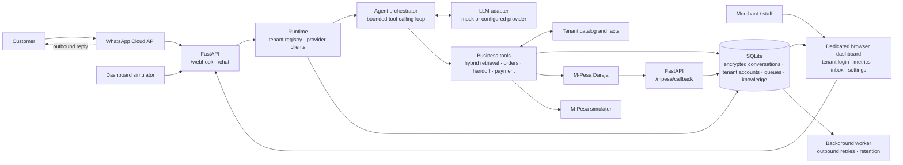
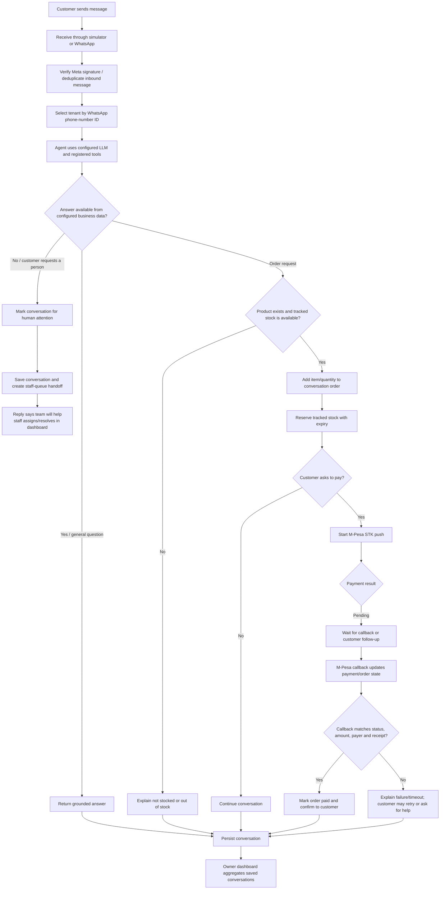

# Hermes architecture and first-pilot readiness

This guide describes the code in this repository today and a practical path to a
first controlled pilot. It is not a claim that the current demo is production
ready.

## Architecture today

The simulator and WhatsApp webhook share the agent core. The provider factories
select real LLM/M-Pesa integrations when configured and otherwise use local
mock/simulator implementations. Merchant catalog and facts, conversations, encrypted provider settings,
documents, handoffs, inbound idempotency and outbound retry state are persisted
in SQLite. Each dashboard session is tenant-scoped. The optional worker runs
outbound retries and daily retention; deploy one API and one worker per SQLite
database.

## Customer conversation and order flow

## What is and is not implemented

**Implemented and covered by offline tests:** email verification before session
and trial activation; invite-only or explicitly enabled signup with IP/email
rate limits; tenant-scoped catalog, conversations, metrics, queues and document
retrieval; encryption of credentials and customer data when
`HERMES_ENCRYPTION_KEY` is configured; consent gates for external LLM/embedding
calls; an in-dashboard handoff queue; inbound idempotency; leased outbound
retries; BM25 plus optional vector retrieval with reciprocal-rank fusion;
operator-run SQLite backup/restore; scheduled retention; plan entitlements,
customer-authorized M-Pesa subscription checkout, grace period and reconciliation;
customer booking with configured weekly hours and 30-minute slots; stock
reservation on order submission and deduction after verified payment; and
campaign attribution from WhatsApp click-to-chat referral source IDs.

**Still required before production:** complete live Meta and Daraja sandbox
rehearsals with merchant credentials, public HTTPS callbacks and designated
test phones; merchant-managed template approval remains an attestation rather
than live Meta status synchronization; SMTP and Hermes billing credentials
must be configured and exercised; external staff notifications and response
time automation; monitoring/alerting and outbound delivery reconciliation;
off-host encrypted backups and a restore drill; key rotation; retrieval-quality
evaluation and stronger source citations; production identity/access review;
and a move from single-instance SQLite if concurrency or uptime needs grow.
Bookings do not yet support deposits, calendar sync, or automated reminders.
Campaign reporting matches referral source IDs and does not provide generalized
UTM attribution or ad-spend reporting. The provider rehearsal button performs
read-only Meta account lookup and Daraja OAuth checks; it does not send
WhatsApp messages, initiate STK prompts, or prove webhook delivery.

## Integration, LLM and retrieval audit

The WhatsApp module contains a real Cloud API text-send call, webhook
verification handshake, inbound parser and HMAC signature check. It now
defaults to Meta Graph API `v26.0`, configurable by environment. The Daraja
module contains OAuth, STK push and status-query calls, plus a shared callback
parser. These establish that real-provider code exists; the repository's
offline tests do **not** make a live Meta or Safaricom request. A successful
factory selection is not evidence that a particular business token, app
permissions, shortcode, transaction type, callback URL or production approval
works. The read-only rehearsal checks account lookup and OAuth token access
only; it does not send a message or payment prompt. Prove webhook delivery,
outbound messaging, STK push and callback handling in Meta's test setup and
Daraja sandbox, then complete a controlled production smoke test.

The project now includes tenant-scoped document ingestion/chunking, BM25
lexical ranking, optional embedding/cosine ranking, and reciprocal-rank fusion.
The dashboard accepts PDF, DOCX/DOCM, XLSX/XLSM, PPTX/PPTM, TXT, Markdown,
CSV, JSON, HTML, XML, YAML, RTF, and EML uploads (15 MB per file). Extraction
runs locally and only text chunks are retained; scanned PDFs require OCR before
upload, and legacy `.doc`, `.xls`, and `.ppt` files are not supported.
Embeddings are only used when the merchant has saved an embedding key and
explicitly consented; each document submission separately confirms indexing
consent. Without that configuration, retrieval is BM25-only. Product prices and
availability still come from the structured catalog. Automated retrieval
evaluation, source citations in customer replies, and durable vector indexing
are not yet implemented. The agent has tools for knowledge lookup, order
capture/edit/removal/cancellation, delivery notes, escalation, M-Pesa checkout
and payment checking.

The LLM interface/provider adapter and bounded tool loop are covered by offline
tests, but real-model quality and provider tool-call compatibility still need
validation with each chosen provider. The system prompt directs the agent to
ground claims in tools and escalate uncertainty; it cannot guarantee that a
model ignores all malicious customer instructions or never answers without a
tool. New tenants use the local mock agent until they explicitly consent to
external LLM processing; per-tenant chat credentials are supported.
Treat structured catalog facts as the source of truth, test retrieval with a
fixed question set, and review transcripts with pilot users before expanding.

## First-pilot gates

Begin with a small invite-only cohort on **one API instance and one worker**.
Conversation records, phone lookups, dashboard metrics, sessions, provider
credentials and inbound routing are tenant-scoped and covered by tests. This is
an application-layer boundary on SQLite, not a substitute for an independent
production security review or infrastructure controls.

Before putting real customers or money through the service:

1. **Agree the pilot boundary.** Pick one shop, one WhatsApp number, a small
   product set, named staff contacts, support hours and a human fallback.
2. **Rehearse handoff.** Confirm staff regularly review and resolve the
   dashboard inbox. The app does not yet notify staff externally or enforce
   response-time targets; agree on an operating schedule and tell customers
   when a person will respond.
3. **Secure the deployment.** Use public HTTPS, generate a unique
   `HERMES_ENCRYPTION_KEY`, set a private `HERMES_INVITE_TOKEN`, keep both in
   deployment secrets, restrict dashboard access, configure per-merchant
   WhatsApp app/verify secrets, and test account deletion and retention. Never
   expose a real customer's data on a public demo.
4. **Exercise real integrations in stages.** Validate Meta webhook handshake,
   signed inbound messages and outbound sends with a test number. Run the
   complete order/payment/callback lifecycle with Daraja sandbox first. Real
   collections also require the merchant's Daraja Go-Live approval and a
   production callback URL.
5. **Protect payment and messaging reliability.** A Daraja status query alone
   never finalizes an order. A success callback must match the provider status,
   expected amount, payer and receipt before it marks the order paid and commits
   reserved stock. Callback messages do not have a cryptographic signature, so
   retain independent reconciliation controls.
   Webhook messages are deduplicated by Meta message ID, and outbound messages
   use a leased retry queue. Run the separate worker and monitor terminal
   failures; independently reconcile M-Pesa settlement records and exercise
   duplicate/out-of-order callbacks before relying on real money flows.
6. **Choose durable pilot hosting.** SQLite is reasonable for a small,
   single-instance pilot if its volume and persistent disk are suitable. Use
   the backup/restore commands, retain off-host backups, protect the encryption
   key separately, and perform a restore drill. Do not run multiple API
   replicas against an unshared SQLite file.
7. **Run an operator rehearsal.** Test FAQ, ambiguous product, unavailable
   product, payment pending/success/failure/timeout, human handoff, webhook
   downtime, order edits/cancellation, retention and restoring a backup.
   Agree who checks the dashboard, reconciles payment and responds when the
   agent or an outbound send fails. Refunds and stock counts still require
   staff-controlled processes.
8. **Measure and review.** Track successful answers, order completion,
   payment reconciliation, handoff response time, failed sends, customer
   complaints and operator time. Review transcripts with pilot users (with
   their knowledge) and make a fix list before expanding.

The repository's unit tests and CI are a good baseline, not a substitute for
this end-to-end sandbox and operational rehearsal. The WhatsApp adapter uses
Meta Graph API `v26.0` by default; confirm the configured version is supported
when deploying because Meta versions have fixed support windows.

## Inventory and bookings

Inventory now reserves tracked stock when an order is submitted, releases it
when payment fails or expires, and deducts it only after callback verification.
If a late success arrives after the reservation has expired and stock is no
longer available, the order is escalated for staff review. Pilot staff should
still reconcile physical counts, cancellations/refunds and any connected POS;
the merchant's actual inventory system remains the source of truth until a POS
integration exists.

Customer booking is available through the tenant's public booking page.
Merchants configure weekly hours and timezone, and the service rejects
overlapping active bookings. Customers can book 30-minute slots and cancel
with their booking reference and original phone. Deposits, calendar sync and
automated reminders remain future work.
